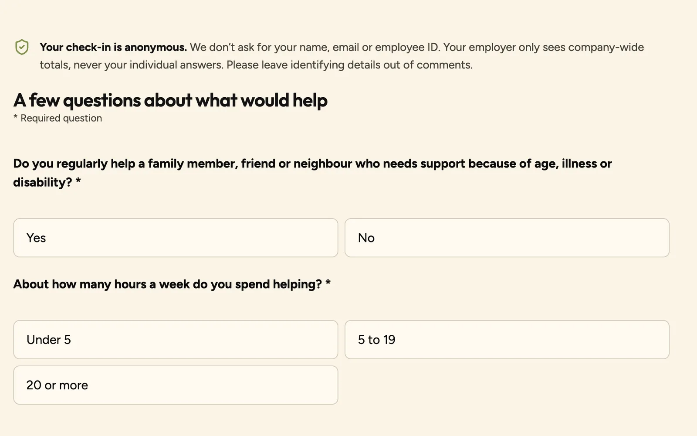
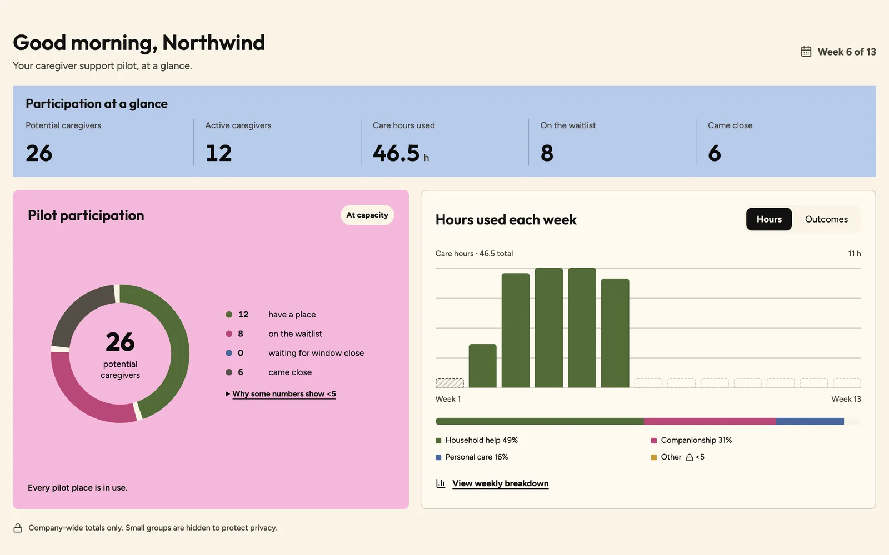
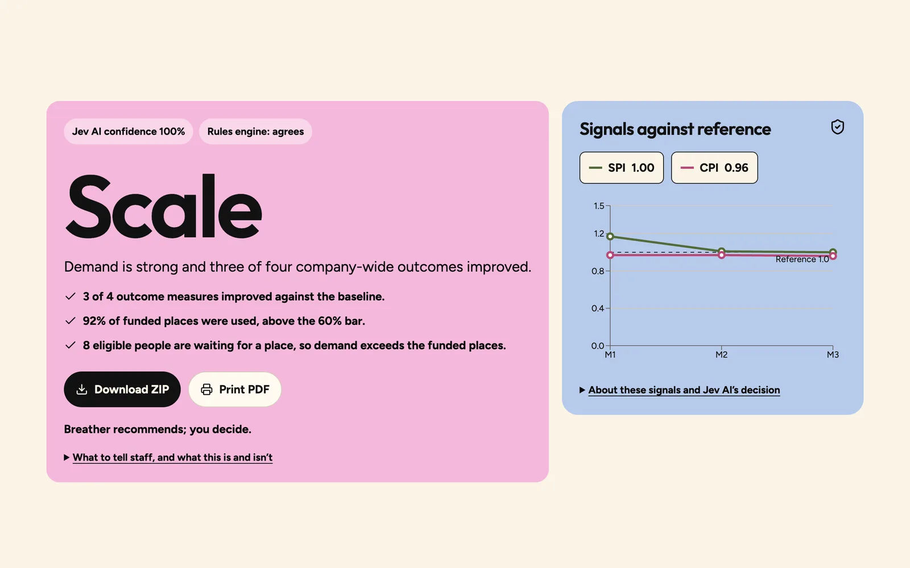
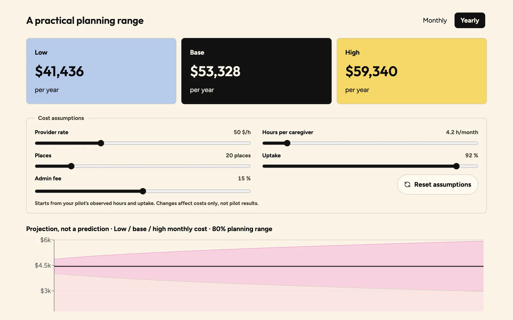
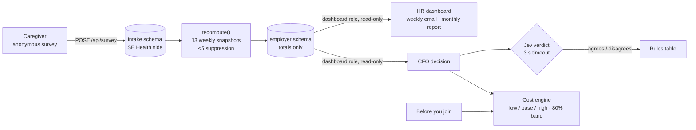

<div align="center">

# Breather

**Run SE Health’s caregiver pilot without the admin, then decide what happens next with evidence instead of guesswork.**

Catalyst 2026 · SE Health “Respite for All” challenge

[](https://breather.dev)

        

</div>

> **Every number in this project is synthetic.** Northwind Logistics is a fictional employer. No real people, employers or emails are involved. Prefer to click through yourself? Open the [live demo](https://breather.dev/demo) on a laptop (it asks for an access code: request one from [breather.dev](https://breather.dev)) and follow the sidebar from top to bottom.

---

## Why we built this

> *“Before my sister passed away, my father cared for her, for the rest of our family, and still had to balance work. We didn’t know about the resources that could have cared for him while he was caring for everyone else. Thirteen-year-old me would have loved to see my dad take a breather.”*
> Chayanth, Breather team

That’s the gap SE Health is trying to close. SE Health offers practical, grant-funded support for working caregivers: household help, companionship and personal care, paid for by the Petro-Canada CareMakers Foundation. When SE Health pitches a respite pilot to an employer, everyone agrees it’s a good idea. **Then the pilot stalls,** because the employer still has three questions nobody can answer for them:

| The employer asks | Why it stops them |
| --- | --- |
| **“What happens when the funding ends?”** | The grant ends March 31, 2027. Nobody wants to start a benefit they’ll have to take away, and there’s no way to know what continuing would cost. |
| **“Do we have time to run this?”** | HR teams are small and already stretched. A pilot that adds paperwork is a pilot that never starts. |
| **“Will our people trust it?”** | Caregivers won’t sign up if they think their employer will know it’s them. Employers still need proof that the pilot is working. |

And the need is real and mostly invisible:

- About **35% of the workforce, 6.1 million employees,** are working caregivers. *(CCCE via Benefits Canada, May 2025)*
- **62% of HR leaders** don’t know how many caregivers they have. *(CCCE)*
- **79%** of caregivers say respite is important, but only **7%** have used it. *(CCCE, Caring in Canada 2026)*

**Who it affects:** caregivers who never get the break, the HR leads who can’t take on another program, the CFOs who won’t fund an unknown, and SE Health, whose mission depends on employers saying yes.

---

## What Breather does

Breather is one pipeline, not seven features. It starts with a calculator before an employer joins and ends with a scale, sustain or stop decision after the 13-week pilot. Data only ever flows one way: **caregivers → SE Health → the employer, as company-wide totals.**

| | Who | What they get |
| --- | --- | --- |
| **Before you join** | A prospective employer | An estimate of how many caregivers they likely have, a $0 pilot cost, and what continuing could cost afterwards |
| **Caregiver survey** | Employees | An anonymous one-minute survey on their phone, with an instant result and a claim number. No name, email or employee ID. |
| **HR dashboard** | HR / benefits lead | Live company-wide totals, a weekly email, and a monthly report, with anything from fewer than 5 people hidden |
| **Pilot decision** | CFO | At week 13: a scale, sustain or stop recommendation with its reasons, the cost to continue as a range, and a 12-month projection the CFO can adjust |

### How to read the demo

The demo is set up like a browser. **The sidebar is the tour:** each item is one step of the pilot, top to bottom. **The screen in the middle is the employer’s own homepage,** built from our [`@breather/brand`](breather-brand/) package so it follows SE Health’s brand guidelines and the employer’s own (here, the fictional Northwind Logistics). The bar at the top lets you move through the 13 pilot weeks and switch between scale, sustain and stop scenarios.

---

## The walkthrough

### 1. Before you join: “What are we signing up for?”

A prospective employer enters its headcount, the share of staff likely to be caregivers and the number of places. Breather estimates how many caregivers they likely have, shows the pilot costs them $0, and gives a range for what continuing would cost, using the same cost engine as the CFO view at the end.

### 2. Sign-up and the caregiver survey: privacy first

When an employer joins, a welcome email (simulated in the demo) tells employees what this is and makes one promise up front: **your employer never sees you, only totals.** The survey takes about a minute and asks for no name, email, employee ID or department. Breather decides eligibility with a plain formula and allocates places automatically, so people are accepted or waitlisted with no HR admin. Each person gets a claim number they can save.



### 3. The HR dashboard: live, weekly and monthly

HR gets a weekly email update, a live dashboard and a monthly report. The dashboard shows participation, care hours by week, the service mix and four outcome measures against the baseline (impact on work, leave days, intent to stay and satisfaction), so HR can see whether flexible hours alone were enough and whether this is working for their people. **Any number from fewer than 5 people shows as “<5”.** There are no department, team or location breakdowns anywhere. In the demo, a survey you submit appears on the dashboard straight away.



### 4. The CFO decision: Breather recommends, the CFO decides

Before week 13 the CFO page just says *“Available at pilot end.”* At week 13 the CFO receives the final report email and opens the decision.



- **The verdict** (scale, sustain or stop) comes from **Jev**, TypeSafe’s decision model, with its confidence and a line saying whether our rules engine agrees.
- **The reasons** are 3–5 plain sentences built from the same company-wide numbers, next to the inputs and the rule each one was checked against.
- **The cost to continue** for 12 months is a low / base / high range, drawn as a band labelled *“Projection, not a prediction”*. Sliders for provider rate, hours per caregiver, places, uptake and admin fee update the cost and the band instantly.



**“Stop” doesn’t mean “abandon.”** When the verdict is stop, Breather still recommends a next step: reevaluate with HSA and SE Health, look at why people didn’t join, and check whether eligibility and services matched what caregivers needed. Support can continue at a scale the employer can manage.

---

## Jev: AI that can’t make things up

We use **[Jev](https://typesafe.ai)** (TypeSafe, `@typesafe-ai/sdk`) for the scale / sustain / stop verdict and, optionally, a personal-information check on focus-group quotes. We designed it so the AI can be trusted with a money decision:

- **Jev only ever sees totals that are already privacy-suppressed,** never an individual answer.
- **Jev returns a category and a confidence, not a paragraph.** Every reason on screen is written by our code from the same totals, so there’s nothing for it to invent.
- **A fixed rules table always runs alongside it.** The screen says “Rules engine: agrees” or “disagrees”, so the CFO can see when the two differ.
- **If Jev fails or takes longer than 3 seconds, the rules table decides,** and the screen shows a “Rules engine” badge instead.
- `npm run verify:jev` runs live Jev against every scenario before it’s allowed on stage. `JEV_MODE=mock` switches live AI off entirely.
- Because Jev returns a structured decision rather than generating text, each call costs a small fraction of a general-purpose LLM call (TypeSafe cites about 400× cheaper).

---

## Privacy you can prove

Privacy isn’t a promise in the pitch, it’s enforced by the database:

- **Two schemas.** Survey answers land in `intake` (SE Health’s side). `recompute()` rebuilds 13 weekly snapshots of company-wide totals into `employer`.
- **The dashboard can’t read `intake`.** HR and CFO views connect through a `dashboard` role that can only `SELECT` from `employer`. `npm run db:prove-wall` connects as that role and gets `permission denied for schema intake`. An ESLint rule stops dashboard code from importing the writer connection.
- **N = 5 suppression, with no subtraction loophole.** Any count, mean, share or total from fewer than 5 people is stored as hidden. If part of a total is hidden, the total is hidden too. A test walks every payload of every scenario to check this.
- **No identifiers on the employer side.** Claim numbers and the optional contact field never leave `intake`. Errors log codes, never request data.

We’re also open about the limits: week-to-week totals can be compared, and a live dashboard shows *that* someone signed up. A real deployment would update HR on a delay, through the weekly email.

---

## Architecture



| Layer | Stack |
| --- | --- |
| App | **Next.js 16** (App Router) · **React 19** · **TypeScript** · **Tailwind v4** · **shadcn/ui** on Base UI · **Lucide** icons |
| Charts | **Recharts**, each with a “View as table” alternative |
| Data | **Supabase Postgres** (transaction pooler) · **Drizzle ORM** · **zod** contracts · SQL migrations as the source of truth |
| AI | **Jev** (`@typesafe-ai/sdk`) with a rules-engine fallback |
| Emails and reports | Welcome, weekly and final emails rendered as in-app previews (nothing is sent) · **pdf-lib** and **JSZip** for the CFO’s downloadable report |
| Brand | **[`@breather/brand`](breather-brand/)**, our own npm package (below) |
| Hosting and CI | **Vercel** (production from `main`, previews per PR) · **GitHub Actions** running typecheck, lint, unit tests and Playwright end-to-end tests with an accessibility check |

---

## Designed, not generated

AI tools make it easy to ship something that looks generic. We decided the design system first and made every screen follow it.

**`@breather/brand`, our npm package.** One package holds SE Health’s brand as code: colour and type tokens, CSS, a Tailwind v4 theme, plain React components (stat cards, pills, the “<5” privacy value, the employer frame) and five brand shapes, plus the [brand guidelines](breather-brand/docs/BRAND-GUIDELINES.md). It includes an employer co-brand layer: each company brings its name and one accent colour, and the package refuses any accent that would break contrast or compete with SE Red. Its tests check every approved colour pairing against WCAG AA.

**The rules every screen follows:** one hero colour, five type styles, nothing smaller than 12px, no all-caps, everything rounded, flat (no shadows), outline icons only, one idea per card, and every screen designed with its empty, loading, locked, error and “<5” states. Accessibility is built in from the start: WCAG 2.1 AA, visible focus, 44px touch targets, labelled controls and charts with text alternatives.

---

## How we built it

We were four people with one weekend, so we treated AI as a team of specialists and kept humans on the decisions.

- **Product first.** A PRD with requirement IDs (SUR, ENG, HR, CFO, PRE, PRV, AI, DEMO, OPS), a technical spec and a team briefing. Every branch and pull request names the requirement it serves. Anything that doesn’t map goes to a parking lot, not into code.
- **Claude Code as the build partner,** with the project rules in `CLAUDE.md` and `AGENTS.md` so every session starts knowing the scope, the privacy rules and the design system.
- **Skills for each kind of work:**
  - **Impeccable** for design craft: critique, layout, typography, polish and hardening.
  - **Intent** for UX structure and copy, with its specialist agents: Noor to set context, Ember to frame the problem, Wren for flows and copy, Vigil for heuristic and accessibility review, Rune for engineering handoff and Sage for brainstorming.
  - **Accessibility skills** (scan, inspect, audit, fix) and a **dataviz** skill before any chart.
  - **Supabase agent skills** for Postgres and database best practices.
- **Prototype, then port.** Vicka designed and prototyped the screens in **Lovable** and explored layouts in **Figma Make**, then ported them into this **Next.js** repo, wired to Glenn’s real API.
- **Guardrails in CI.** Typecheck, lint, unit tests (including the privacy guard), Playwright end-to-end tests with an axe WCAG 2.1 AA check on every page, `npm run checkpoint` as a GO/NO-GO check against the live deployment, and `npm run verify:jev` before going live on stage.

---

## Can this actually ship?

Yes, and that was the point. Breather fits the pilot SE Health is already running:

- **No integrations to set up.** No HR, payroll or SSO connection is needed. An employer shares one survey link.
- **Less than half a day a week for HR** once it’s running *(SE Health estimate)*. Eligibility, allocation, the waitlist, weekly updates and the monthly report are automatic.
- **Built for SE Health’s real numbers:** about 10–15 caregivers per employer, up to about $500 each, funding until March 31, 2027.
- **It helps recruit employers.** The “before you join” page answers the cost and capacity questions before the first meeting, which is exactly where SE Health’s pipeline stalls.

**Measurable impact.** Each pilot ends with four outcome measures against a baseline (impact on work, leave days, intent to stay, satisfaction), uptake against places, and demand from the waitlist. Every employer leaves with a decision and the evidence behind it.

**To scale beyond the demo:** real sign-in, many employers per SE Health account, scheduled (not live) HR updates, and real email delivery. The data model and the privacy wall already separate SE Health’s side from the employer’s, so adding employers doesn’t weaken privacy.

---

## Our hackathon

- **Day 1: understand the problem.** We started from SE Health’s case study and an interview that settled our open questions. The biggest change: eligibility became simpler, because SE Health told us strict rules were Phase 1’s biggest barrier (people ruled themselves out).
- **A design workshop changed how we built.** A session on designing with AI made us lock a design system before writing UI: one hero colour, five type styles, consistent rounded components, and an accessibility checklist. SE Health’s own brand placemat became the authority for colour and type.
- **Parallel tracks, one contract.** Glenn built the database, engines, API and CI against zod contracts while Vicka prototyped the UI against fixtures with the same shape, so the two met cleanly when the final UI was wired to the real API.
- **The name.** We started as “Pilot Hub” and renamed to **Breather** at 3 AM, because that’s what the product is for.
- **What we learned:** decide the scope and the design system before prompting. Make privacy something the code enforces and you can demonstrate. Make the AI show its working.

---

## Run it locally

```bash
npm ci
cp .env.example .env.local   # values: ask Glenn (DM only)
                             # also set DEMO_ACCESS_CODES and DEMO_COOKIE_SECRET (32+ characters), or /demo stays locked
npm run dev                  # http://localhost:3000
```

<details>
<summary><b>Technical reference: APIs, scripts and environments</b></summary>

### How a submission flows

1. A caregiver opens the employer’s private survey link (`/s/demo`) and submits.
2. A plain formula (not AI) decides eligibility. Allocation then gives the person a place, a pending status or a waitlist spot.
3. The answers are stored in the `intake` schema, the SE Health side.
4. `recompute()` rebuilds 13 weekly snapshots of company-wide totals, hides every value from fewer than 5 people, and writes them to the `employer` schema.
5. The HR and CFO views read only those snapshots, through a role with no access to `intake`.
6. At week 13 the CFO view shows the verdict, the cost to continue (low, base, high) and a projection band that widens over 12 months.

### API

| API | What it does |
|---|---|
| `POST /api/survey` | Submit the survey. Returns `accepted`, `waitlisted` or `pending` with a claim number, or `not_eligible` |
| `GET /api/dashboard?week=1..13` | One pre-computed, suppressed snapshot (read-only role) |
| `POST /api/verdict` | Scale, sustain or stop with reasons and inputs. Returns `409` before week 13 |
| `POST /api/cost` | Cost to continue and projection band for the given assumptions |
| `POST /api/preview` | “Before you join” estimate from headcount (same cost function) |
| `POST /api/demo/seed?scenario=scale\|sustain\|stop` | Reset the demo to a synthetic scenario |

### Scripts

| Script | What it does |
|---|---|
| `npm run typecheck` / `lint` / `test` | Checks run in CI on every pull request (unit tests include the privacy guard) |
| `npm run test:e2e` | Playwright: survey → HR → CFO via the real APIs, plus accessibility (WCAG 2.1 AA) |
| `npm run seed -- scale\|sustain\|stop` | Load a synthetic scenario into the database in `.env.local` |
| `npm run checkpoint -- <url>` | End-to-end GO/NO-GO check against a running deployment (resets to `scale` at the end). Needs `CHECKPOINT_ACCESS_CODE`, a code from that deployment’s `DEMO_ACCESS_CODES` |
| `npm run verify:jev -- 5` | Live Jev on each scenario 5 times; must all pass before using `JEV_MODE=live` on stage |
| `npm run db:migrate` | Apply `db/migrations/*.sql` (schemas, tables, `dashboard` role and grants) |
| `npm run db:prove-wall` | Show that the `dashboard` role cannot read `intake` |
| `npm run fixtures` | Regenerate `fixtures/*.json` from the real pipeline |

### Environments

| | Demo database | Preview database |
|---|---|---|
| Used by | **Production** (`main` → the live demo) | **Preview** deployments, CI e2e, local testing |
| Local env file | `.env.local` | `.env.preview.local` (`set -a; source .env.preview.local; set +a` before a command) |

Both use the Supabase **transaction pooler** (port 6543). `db/migrations/` is the source of truth for the schema: change it with a new migration file, never in the SQL editor. Do not expose `intake` or `employer` through Supabase’s Data API. CI e2e runs only against the preview database and refuses the demo database; it can be paused with the repo variable `E2E_PAUSED=true`.

</details>

---

## Honest by design

- **Out of scope for this demo:** real authentication, multiple employers, HR or payroll integrations, booking or delivering care, real data, department breakdowns, sending real email, and any causal or ROI claim (“respite saves you $X”).
- **Sources:** every external figure in the app, with its source and year, is in [`config/sources.ts`](config/sources.ts). Assumptions such as $50/hour care and a 15% admin fee are labelled on screen and can be edited.

## Team

**Glenn**, backend, data and infrastructure · **Chayanth**, project management, code review and PR approvals · **Victoria**, frontend, design and the brand package · **Giada**, research and pitch

<div align="center">
<br>
<b>Breather recommends. You decide.</b>
<br><br>
Built for SE Health at Catalyst 2026
</div>
---

© 2026 Glenn Salvador, Victoria Chernobay, Giada Laceda and Chayanth Suthahar. All rights reserved. See LICENSE.
